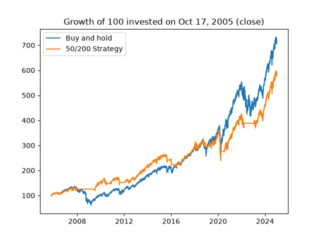
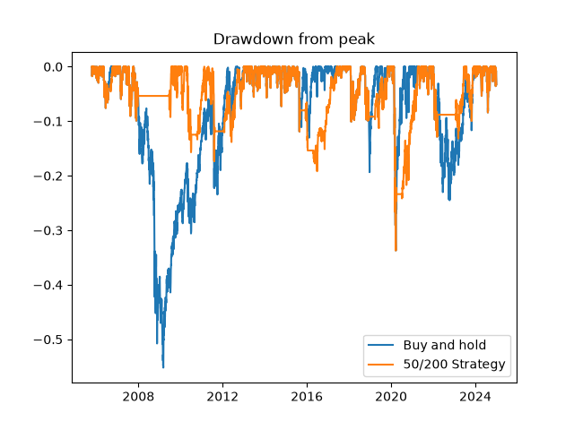

# Backtest: 50/200 moving average crossover vs buy and hold on SPY

## Question

Does a 50/200-day moving average crossover strategy perform better than buy and hold on SPY since 2005, and why?

## Answer

No in terms of return, yes in terms of risk. Buy and hold earns more (10.7% a year against 9.6%; 100 grows to 708 against 578), but the strategy is less risky: volatility of 13.6% against 19.3%, maximum drawdown of -33.7% against -55.2%, and a higher Sharpe ratio (0.74 against 0.63).
It avoids long bear markets like 2008, but because moving averages lag, it gets back in late and misses fast rebounds like 2009 and 2020.

## Data

SPY daily adjusted close prices (dividends and splits included) from Yahoo Finance, downloaded with `yfinance`, from Jan 3, 2005 to Dec 31, 2024, saved in `data/spy.csv`.
The comparison starts on Oct 18, 2005, the first day the strategy can take a position: 4,833 trading days.

## Strategy

- Invested in SPY when the 50-day moving average is above the 200-day moving average; in cash otherwise (0% return). No short selling.
- The position is decided with the previous day's close, to avoid look-ahead bias.

## Results

Period: Oct 18, 2005 to Dec 31, 2024 (4,833 trading days).

| | Buy and hold | 50/200 strategy |
|---|---|---|
| Final value of 100 | 708.2 | 577.8 |
| Annualized return | 10.7% | 9.6% |
| Annualized volatility | 19.3% | 13.6% |
| Sharpe ratio (risk-free rate = 0) | 0.63 | 0.74 |
| Maximum drawdown | -55.2% | -33.7% |
| Position changes | 0 | 18 |

## Charts



The strategy stays in cash during the 2008 crash and leads until early 2019. It falls behind in 2020, when it takes the Covid crash and then misses the rebound.



Buy and hold falls 55% in 2008-2009, while the strategy never loses more than 10% over that period. The strategy's worst drawdown comes in March 2020 (-34%).

## Limits

- **No transaction costs.** With only 18 position changes in 19 years, they would barely change the result.
- **Execution at the close of the signal day.** Trading one day later, the strategy ends at 544 instead of 578: the result depends on execution.
- **Cash earns 0%, and the Sharpe ratio uses a 0% risk-free rate.** In reality, cash earns interest (around 5% in 2023-2024), which would slightly help the strategy.
- **One asset, one period, one pair of moving averages.** The 50/200 pair was chosen in advance, not optimized: testing many pairs and keeping the best one would be overfitting.
- **Sharpe convention:** mean daily return x 252 / annualized volatility.

## How to run

Requires Python 3.11 or later. The data is saved in the repo (`data/spy.csv`), so nothing needs to be downloaded.

```
git clone https://github.com/Willys94/backtest-moyennes-mobiles.git
cd backtest-moyennes-mobiles
python -m venv .venv
.venv\Scripts\activate
pip install -r requirements.txt
```

On macOS or Linux, activate the environment with `source .venv/bin/activate`.

Then open `backtest.ipynb` in VS Code (Python and Jupyter extensions), select the `.venv` kernel and run all cells.